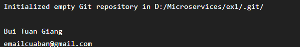
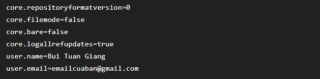

# Bài 1: Khởi tạo Local Repository và Cấu hình danh tính

## 1. Mục tiêu

* Khởi tạo Git repository tại máy local.
* Cấu hình tên và email tác giả ở cấp độ local.
* Tạo file và đưa vào Staging Area.
* Thực hiện commit đầu tiên.
* Kiểm tra trạng thái và lịch sử commit.

## 2. Các lệnh đã thực hiện

### Khởi tạo repository

```bash
git init
```

### Cấu hình danh tính local

```bash
git config --local user.name "Bui Tuan Giang"
git config --local user.email "email-cua-ban@example.com"
```

### Kiểm tra cấu hình

```bash
git config --local user.name
git config --local user.email
```

### Tạo file

```bash
echo "Git Exercise 1" > README.md
```

### Đưa file vào Staging Area

```bash
git add README.md
```

### Commit đầu tiên

```bash
git commit -m "Initial commit"
```

### Kiểm tra lịch sử commit

```bash
git log --oneline
```

## 3. Kết quả kiểm tra

### Kiểm tra user.name

```text
Bui Tuan Giang
```

### Kiểm tra user.email

```text
email-cua-ban@example.com
```

### Kiểm tra cấu hình local

```bash
git config --local --list
```

Kết quả có:

```text
user.name=Bui Tuan Giang
user.email=email-cua-ban@example.com
```

### Lịch sử commit

```bash
git log --oneline
```

Kết quả:

```text
<commit-id> (HEAD -> master) Initial commit
```

## 4. Kết luận

Đã khởi tạo thành công Git repository local, cấu hình danh tính tác giả bằng tùy chọn `--local`, tạo file, đưa file vào Staging Area và thực hiện commit đầu tiên thành công.



