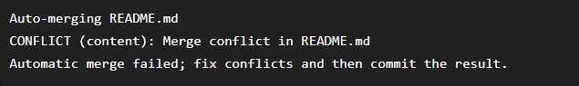
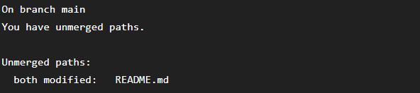
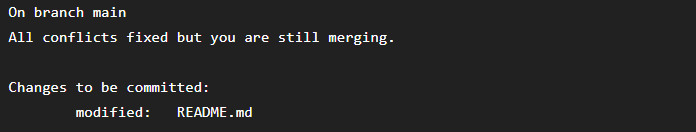
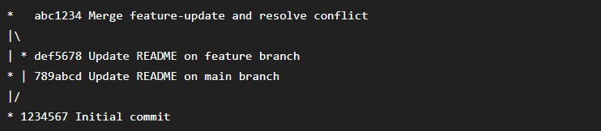
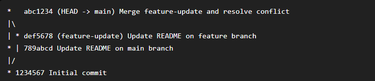

# Bài 2: Quản lý nhánh và Giải quyết xung đột

## 1. Mục tiêu

* Tạo và chuyển đổi giữa các branch.
* Tạo Merge Conflict giữa `main` và `feature-update`.
* Xử lý conflict thủ công.
* Hoàn thành Merge Commit.
* Kiểm tra lịch sử commit bằng biểu đồ nhánh.

## 2. Các bước thực hiện

### Khởi tạo repository

```bash
git init
git branch -M main
```

### Tạo nhánh feature

```bash
git branch feature-update
git switch feature-update
```

### Thay đổi trên feature-update

```bash
git add README.md
git commit -m "Update README on feature branch"
```

### Chuyển về main

```bash
git switch main
```

Sau đó thay đổi cùng dòng trong `README.md` và commit:

```bash
git add README.md
git commit -m "Update README on main branch"
```

### Tạo Merge Conflict

```bash
git merge feature-update
```

Git phát hiện xung đột vì hai nhánh cùng thay đổi một dòng trong `README.md`.

## 3. Giải quyết xung đột thủ công

Git tạo các ký hiệu:

```text
<<<<<<< HEAD
Version main
=======
Version feature-update
>>>>>>> feature-update
```

Em mở file `README.md`, kiểm tra nội dung của hai nhánh và chỉnh sửa thủ công.

Sau khi giải quyết, các ký hiệu `<<<<<<<`, `=======`, `>>>>>>>` được xóa hoàn toàn.

Sau đó thực hiện:

```bash
git add README.md
```

Kiểm tra trạng thái:

```bash
git status
```

## 4. Hoàn thành Merge Commit

```bash
git commit -m "Merge feature-update and resolve conflict"
```

## 5. Kiểm tra lịch sử

```bash
git log --graph --oneline --decorate
```

Kết quả cho thấy nhánh `feature-update` được tách từ `main`, có các commit riêng và sau đó được merge trở lại `main` bằng một Merge Commit.

## 6. Kết quả

Đã tạo thành công Merge Conflict giữa `main` và `feature-update`, xử lý xung đột thủ công trong `README.md` và hoàn thành Merge Commit.

Working tree sau khi hoàn thành:

```text
nothing to commit, working tree clean
```





