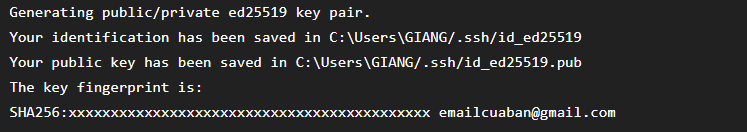

# Bài 3: Cấu hình xác thực SSH và Đẩy dự án lên GitHub

## 1. Mục tiêu

* Tạo cặp khóa SSH sử dụng thuật toán Ed25519.
* Cấu hình xác thực SSH với GitHub.
* Liên kết repository local với repository trên GitHub bằng giao thức SSH.
* Push mã nguồn và lịch sử commit lên GitHub.

## 2. Tạo SSH Key Ed25519

Sử dụng lệnh:

```bash
ssh-keygen -t ed25519 -C "emailcuaban@gmail.com"
```

Khóa được tạo gồm:

```text
id_ed25519
id_ed25519.pub
```

Trong đó `id_ed25519` là private key và không được chia sẻ.

`id_ed25519.pub` là public key và được thêm vào tài khoản GitHub.

## 3. Kiểm tra kết nối GitHub

Sử dụng:

```bash
ssh -T git@github.com
```

Kết quả xác nhận:

```text
Hi username! You've successfully authenticated, but GitHub does not provide shell access.
```

## 4. Cấu hình Git Remote

Thêm remote bằng giao thức SSH:

```bash
git remote add origin git@github.com:username/repository.git
```

Kiểm tra:

```bash
git remote -v
```

Kết quả:

```text
origin  git@github.com:username/repository.git (fetch)
origin  git@github.com:username/repository.git (push)
```

## 5. Push project lên GitHub

```bash
git push -u origin main
```

Sau khi push thành công, mã nguồn và lịch sử commit đã được đưa lên repository GitHub.

## 6. Repository GitHub

Repository:

```text
git@github.com:username/repository.git
```

## 7. Kết luận

Đã tạo thành công SSH key sử dụng thuật toán Ed25519, cấu hình public key trên GitHub, thiết lập remote repository bằng giao thức SSH và push thành công project lên GitHub.

Private key `id_ed25519` không được đưa lên GitHub.



