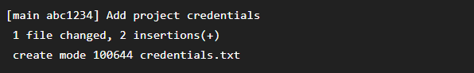
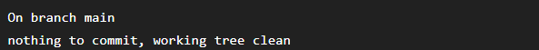
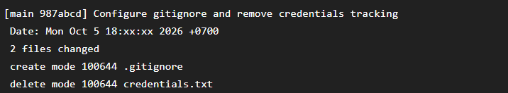
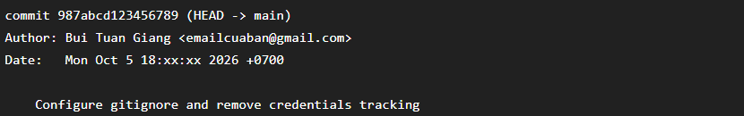
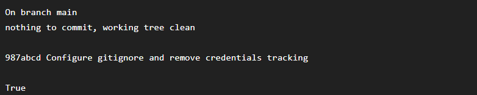

# Bài 4: Quản lý tệp tin bỏ qua (.gitignore) và Sửa lịch sử (Amend)

## 1. Mục tiêu

* Tạo file `.gitignore`.
* Cấu hình Git bỏ qua các file nhạy cảm.
* Gỡ `credentials.txt` khỏi Git tracking nhưng không xóa file vật lý.
* Sử dụng `git commit --amend` để sửa thông điệp commit gần nhất.

## 2. Tình huống ban đầu

Tạo file `credentials.txt` và commit nhầm vào repository:

```bash
git add credentials.txt
git commit -m "Add project credentials"
```

File đã được Git theo dõi.

## 3. Tạo `.gitignore`

Tạo file `.gitignore` với nội dung:

```text
credentials.txt
.env
*.log
```

Trong đó `credentials.txt` được cấu hình để Git bỏ qua trong các lần theo dõi tiếp theo.

## 4. Gỡ credentials.txt khỏi Git tracking

Vì `credentials.txt` đã được commit trước đó nên chỉ thêm vào `.gitignore` là chưa đủ.

Sử dụng:

```bash
git rm --cached credentials.txt
```

Tùy chọn `--cached` chỉ loại file khỏi Git index/tracking, không xóa file vật lý khỏi thư mục làm việc.

Kiểm tra file vẫn còn trên máy:

```bash
Test-Path credentials.txt
```

Kết quả:

```text
True
```

## 5. Commit thay đổi

```bash
git add .gitignore
git commit -m "Add gitignore and remove credentials tracking"
```

## 6. Sửa commit gần nhất bằng Amend

Sử dụng:

```bash
git commit --amend -m "Configure gitignore and remove credentials tracking"
```

Lệnh `--amend` thay thế commit gần nhất bằng một phiên bản mới có thông điệp đã chỉnh sửa.

## 7. Kiểm tra lịch sử

```bash
git log -n 1
```

Kết quả hiển thị commit gần nhất với thông điệp:

```text
Configure gitignore and remove credentials tracking
```

## 8. Kiểm tra trạng thái

```bash
git status
```

Kết quả:

```text
nothing to commit, working tree clean
```

`credentials.txt` không còn được Git theo dõi và file vật lý vẫn tồn tại trong thư mục local.

## 9. Kết luận

Đã tạo thành công `.gitignore`, gỡ `credentials.txt` khỏi Git tracking bằng `git rm --cached` mà không xóa file vật lý, đồng thời sử dụng `git commit --amend` để sửa thông điệp của commit gần nhất.





